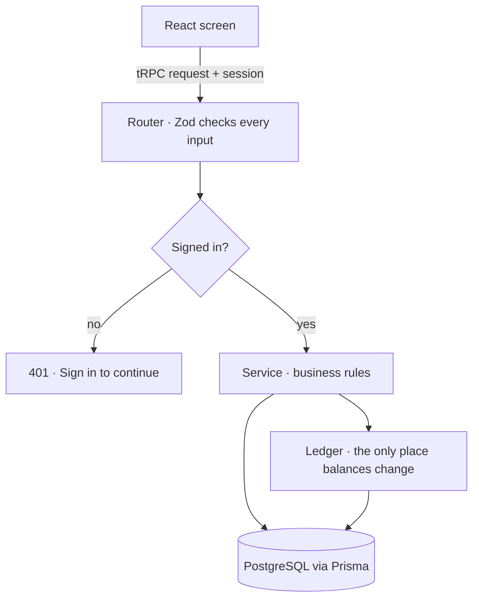
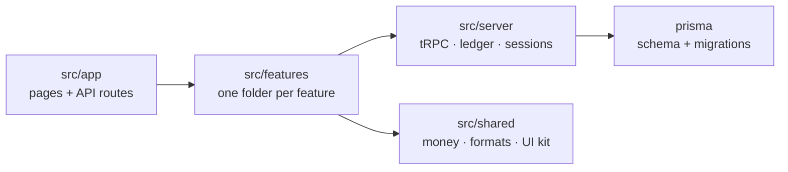
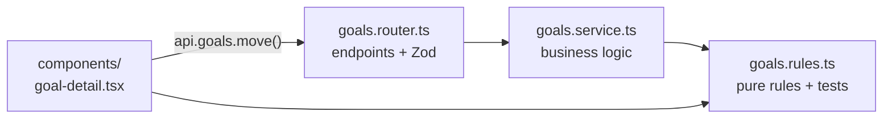
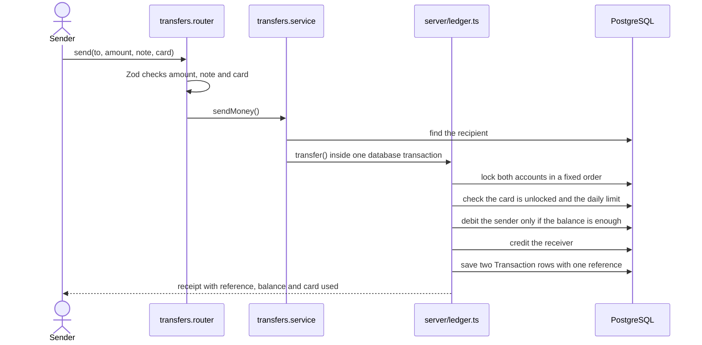
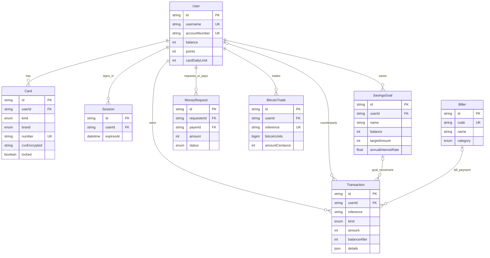

# GoBank Express

GoBank Express is a mobile-first digital bank for students. It lets them pay, save toward goals and earn cash back from one app, with every peso tracked safely on the server.

## Features

| Feature          | What it does                                                                            |
| ---------------- | --------------------------------------------------------------------------------------- |
| Account and card | Main balance, a physical and a virtual card, each locked separately, shared daily limit |
| Send and request | Pay friends by username, account number, mobile or linked Gmail; request money          |
| Bills and load   | Pay electric, water, internet and credit card billers; buy mobile load                  |
| GoalSave         | Up to 5 savings goals earning 4% a year, compounded daily                               |
| Rewards          | 1 point per ₱50 spent, 100 points = ₱1.00 cash back                                     |
| Transactions     | Full history with filters and receipts, each showing the card used                      |
| Sign-in          | Username and 6-digit PIN, or Google followed by the PIN; link Google later in profile   |
| Bitcoin          | Practice trading with live prices, charts and a fixed ₱10 fee                           |

## Tech stack

| Area         | Tools                                                    |
| ------------ | -------------------------------------------------------- |
| Language     | TypeScript 5                                             |
| Framework    | Next.js 15 (App Router), React 19                        |
| API          | tRPC 11 with Zod 3 input checks and SuperJSON            |
| Database     | PostgreSQL on Neon (Singapore), Prisma 6 ORM             |
| Data loading | TanStack Query 5                                         |
| Styling      | Tailwind CSS 4, Lucide icons                             |
| Auth         | Username + PIN (scrypt), Google OAuth with PKCE          |
| Testing      | Node test runner, database integration tests, Playwright |
| Quality      | ESLint 9, Prettier 3, GitHub Actions CI                  |

## Quick start

Requires **Node.js 22** and a PostgreSQL database (a free [Neon](https://neon.tech) project in the Singapore region).

```bash
git clone https://github.com/neilacapuccino/gobank-express.git
cd gobank-express/gobank
npm ci
cp .env.example .env
npm run card:setup-key
npm run db:migrate
npm run db:seed
npm run dev
```

Open **http://localhost:3001** and sign in as **@maricel** or **@dante** with PIN **135790**.

| `.env` variable                            | Where to get it                                                      |
| ------------------------------------------ | -------------------------------------------------------------------- |
| `DATABASE_URL`                             | Neon → **Connect**, pooling **on**                                   |
| `DIRECT_URL`                               | Neon → **Connect**, pooling **off**                                  |
| `CARD_ENCRYPTION_KEY`                      | `npm run card:setup-key`; everyone on one database uses the same key |
| `AUTH_SECRET`                              | Any random 32+ characters (needed for Google)                        |
| `GOOGLE_CLIENT_ID`, `GOOGLE_CLIENT_SECRET` | Optional, see below; leave empty to hide the Google button           |

**Google sign-in:** in [Google Cloud Console](https://console.cloud.google.com/), create an OAuth client ID (**Web application**), add the redirect URI `http://localhost:3001/api/auth/google/callback`, and copy the ID and secret into `.env`. Existing users can add Google under **Settings → Edit profile → Link Google**.

## Architecture

Every request goes through the same layers. Each layer does one job.



## Project structure

How the folders depend on each other:



What is inside every feature folder, using `goals` as the example:



```text
gobank/src
├── app/        pages: dashboard, card, goals, bills, ... and api/trpc, api/session, api/auth/google
├── features/   account, activity, auth, bills, bitcoin, card, deposit, goals,
│               load, notifications, requests, rewards, transfers
├── server/     trpc.ts, root.ts, ledger.ts, session.ts, db.ts, errors.ts, pagination.ts
└── shared/     lib/ (money, format, schemas), ui/ (buttons, forms, PIN pad), hooks/
```

| File suffix                 | What it holds                                    |
| --------------------------- | ------------------------------------------------ |
| `.router.ts`                | API endpoints and input checks                   |
| `.service.ts`               | Business logic and database work                 |
| `.rules.ts`                 | Pure limits and calculations, unit tested        |
| `.server.ts` / `.client.ts` | Code that runs only on the server / in a browser |
| `.test.ts`                  | Unit tests next to the code they test            |

## How a transfer moves money



If any step fails, the whole transaction rolls back and no money moves.

## Security and limits

- **PINs** are hashed with scrypt; 5 wrong PINs lock the account for 15 minutes.
- **Sessions** are random tokens stored hashed, sent as an httpOnly cookie, tied to one browser tab, and expire after 30 idle minutes.
- **Card CVVs** are encrypted with AES-256-GCM; Google sign-in uses OAuth with PKCE.
- **Double clicks and parallel requests** cannot overdraw: balance updates are conditional and rows are locked with `SELECT … FOR UPDATE`.

| Action                | Limit                                                           |
| --------------------- | --------------------------------------------------------------- |
| Deposit               | up to ₱50,000 each                                              |
| Send money, pay bills | balance and daily limit (default ₱20,000/day, max ₱100,000/day) |
| Buy load              | ₱10 to ₱10,000                                                  |
| Request money         | up to ₱20,000                                                   |
| GoalSave              | 5 goals, names up to 40 characters                              |
| Convert points        | multiples of 100                                                |

## Database



- **Money** is in centavos (₱100.00 = 10,000). Negative amounts leave the account; `balanceAfter` is the balance right after.
- **A transfer** writes two `Transaction` rows with the same reference, one for each person.
- **GoalSave** goals are the `SavingsGoal` table; interest is settled whenever a goal is opened.

## Scripts

Run inside `gobank/`.

| Command                    | What it does                                 |
| -------------------------- | -------------------------------------------- |
| `npm run dev`              | Start the app on port 3001                   |
| `npm run db:migrate`       | Apply database migrations (safe to repeat)   |
| `npm run db:seed`          | Add billers and the two demo accounts        |
| `npm test`                 | Unit tests                                   |
| `npm run test:integration` | Full banking flow against the database       |
| `npm run test:e2e`         | Browser tests in Google Chrome               |
| `npm run check:ci`         | Format, lint, typecheck, tests and the build |

**Deploying (Vercel):** set the root directory to `gobank`, add the `.env` values, run `npm run db:migrate` once, and add `https://<your-domain>/api/auth/google/callback` to Google.

## Troubleshooting

- **`P1001: Can't reach database server`**: Neon is waking up; run the command again.
- **`EPERM … query_engine` on Windows**: stop `npm run dev` before `npm ci` or `npx prisma generate`.
- **Building while the dev server runs**: use `NEXT_DIST_DIR=.next-build npm run build`, or the dev server breaks.
- **Signed out after opening a new tab**: expected; a session belongs to one tab.
