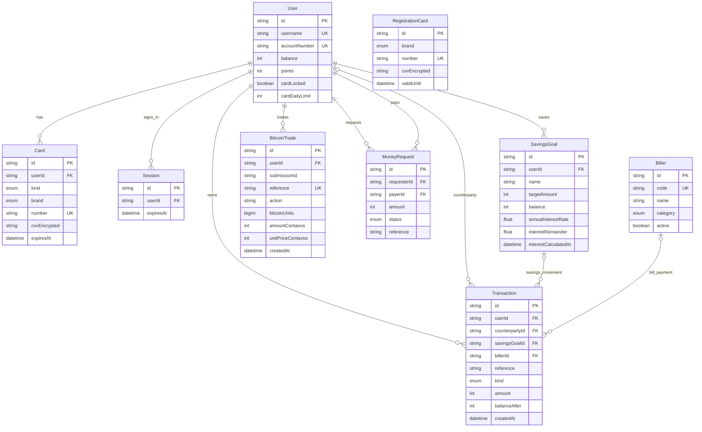

# GoBank Express

A mobile-first student banking app built with **Next.js 15, TypeScript, tRPC 11, Prisma 6 and PostgreSQL**. All amounts are Philippine pesos (₱); the database stores money as whole centavos.

## Features

- **Main account and cards** — account number, spending balance, a physical and a virtual card, lock/unlock and a daily spending limit.
- **GoalSave (Stashes)** — up to 5 named savings goals earning 4% p.a., compounded daily.
- **Transfers and bills** — send money by username, account number, mobile or linked Gmail; request money; pay billers; buy mobile load. Every movement gets a reference number, timestamp and balance snapshot.
- **Rewards** — 1 point per ₱50 on transfers and bill payments; 100 points = ₱1.00 cash back.
- **Sign-in** — username + 6-digit PIN, or Continue with Google followed by the PIN.
- **Extra** — Bitcoin practice trading at `/stocks`.

## Run it locally

Requires **Node.js 20+** and a **PostgreSQL** database (a free [Neon](https://neon.tech) project works).

```bash
git clone https://github.com/neilacapuccino/gobank-express.git
cd gobank-express/gobank
npm ci
cp .env.example .env
```

Fill in `gobank/.env`:

| Variable | Needed for | How to get it |
| --- | --- | --- |
| `DATABASE_URL` | everything | Neon → **Connect** → copy the connection string with **pooling on** |
| `DIRECT_URL` | migrations | Same screen with **pooling off** |
| `CARD_ENCRYPTION_KEY` | cards | Run `npm run card:setup-key` (adds it to `.env`). Everyone sharing one database must use the **same** key. |
| `AUTH_SECRET` | Google sign-in | Any random 32+ characters, e.g. `node -e "console.log(require('crypto').randomBytes(32).toString('hex'))"` |
| `GOOGLE_CLIENT_ID`, `GOOGLE_CLIENT_SECRET` | Google sign-in | See below. Leave empty to hide the Google button. |

Then set up the database and start the app:

```bash
npm run card:setup-key
npm run db:migrate
npm run db:seed
npm run dev
```

Open **http://localhost:3001**. The seed adds billers and two demo accounts, **@maricel** and **@dante**, both with PIN **135790**.

### Google sign-in (optional)

1. Open [Google Cloud Console](https://console.cloud.google.com/) → **APIs & Services** → **OAuth consent screen**, choose **External**, and add your Gmail as a test user.
2. **Credentials** → **Create credentials** → **OAuth client ID** → **Web application**.
3. Add the authorized redirect URI `http://localhost:3001/api/auth/google/callback`.
4. Copy the client ID and secret into `.env`, set `AUTH_SECRET`, and restart `npm run dev`.

A Google account that matches an existing user still has to enter that user's PIN. A new Google account goes through normal registration.

## How the backend works

```text
React screen ──► tRPC client ──► /api/trpc ──► router (Zod input) ──► service ──► Prisma ──► PostgreSQL
                                               protectedProcedure      ledger.ts
                                               checks the session      (all money moves)
```

| Layer | Location | Job |
| --- | --- | --- |
| Routes | `src/app/` | Pages and API routes; `(app)/layout.tsx` redirects signed-out users |
| Routers | `src/features/*/*.router.ts` | Validate every input with Zod (types, min/max, formats) |
| Services | `src/features/*/*.service.ts` | Business rules and database work |
| Rules | `src/features/*/*.rules.ts`, `src/shared/lib/` | Pure limits and calculations, unit tested |
| Ledger | `src/server/ledger.ts` | The only place balances change |
| Core | `src/server/` | Prisma client, sessions, tRPC setup, error mapping |

**Money safety**

- Each money action runs in one database transaction: the balance update and its `Transaction` row commit together or not at all.
- Balance updates are conditional (`balance >= amount`) and rows are locked with `SELECT … FOR UPDATE`, so double clicks and parallel requests cannot overdraw.
- Transfers lock both accounts in a fixed order to avoid deadlocks and share one reference between sender and receiver.
- Spending checks the card lock and the daily limit (Asia/Manila day) on the server; the UI shows the same limits before you submit.

**Sessions and security**

- PINs are hashed with scrypt; 5 wrong PINs lock the account for 15 minutes.
- Sessions are random tokens stored hashed in the `Session` table and sent as an httpOnly cookie. They expire after 30 minutes without activity and are tied to the browser tab, so opening the app in a new tab asks you to sign in again.
- Card CVVs are encrypted with `CARD_ENCRYPTION_KEY`; Google sign-in uses OAuth with PKCE and a signed, short-lived cookie.

**Limits**

| Action | Limit |
| --- | --- |
| Deposit | up to ₱50,000 each |
| Send money, bills | up to your balance and the card's remaining daily limit (default ₱20,000/day, max ₱100,000) |
| Buy load | ₱10 – ₱10,000, counts toward the daily limit |
| Request money | up to ₱20,000 |
| GoalSave | 5 goals, names up to 40 characters |
| Redeem points | multiples of 100 |

## Database

PostgreSQL through Prisma (`gobank/prisma/schema.prisma`). Key fields only; `PK` primary key, `FK` foreign key, `UK` unique.



- **Money** is stored in whole centavos (₱100.00 = 10,000). Transaction amounts are signed: negative leaves the account, positive enters it, and `balanceAfter` is the snapshot.
- **Cards**: each user has one physical and one virtual card (unique by `userId + kind`); both spend from `User.balance` and share its lock and daily limit.
- **Transfers** write two `Transaction` rows with the same reference, one per user; `counterpartyId` points to the other person. Transactions are unique by `reference + userId`.
- **Money requests** store requester, payer, amount and status; paying one creates a transfer and keeps its reference.
- **GoalSave** is the `SavingsGoal` model (unique by `userId + name`). `annualInterestRate` is 0.04, `interestCalculatedAt` is the last settlement and `interestRemainder` carries fractions of a centavo.
- **Registration cards** are 30-minute reservations shown during sign-up; registering moves them to the user's physical card.
- **Bitcoin** trades are stored in whole units (1 BTC = 100,000,000), and holdings are calculated from the trade history.

## Scripts

Run inside `gobank/`.

| Command | What it does |
| --- | --- |
| `npm run dev` | Start the app on port 3001 |
| `npm run db:migrate` | Apply committed migrations |
| `npm run db:seed` | Add billers and demo accounts |
| `npm run db:studio` | Browse the database |
| `npm test` | Unit tests |
| `npm run test:integration` | Full banking flow against the database (creates and removes its own test accounts) |
| `npm run check:ci` | Format, lint, typecheck, unit tests and production build |

## Troubleshooting

- **`P1001: Can't reach database server`** — Neon may be waking up; run the command again.
- **`EPERM … query_engine` on Windows** — stop `npm run dev` before `npm ci` or `npx prisma generate`.
- **Signed out after opening a link in a new tab** — expected; sessions belong to one tab.
- **Port 3001 in use** — close the other dev server first.
